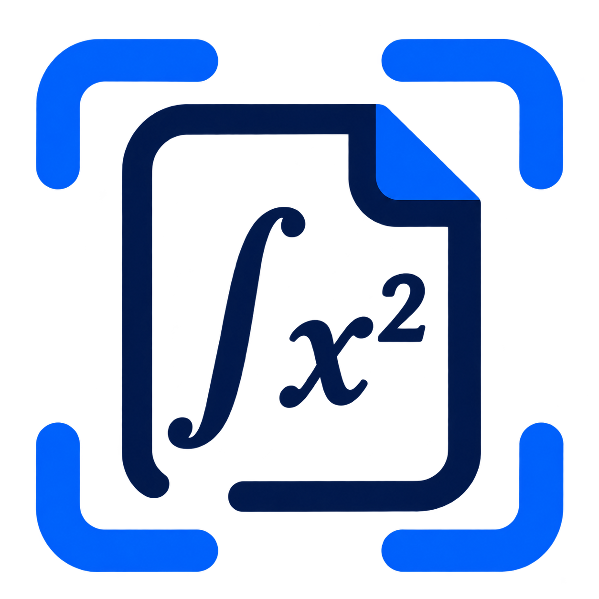
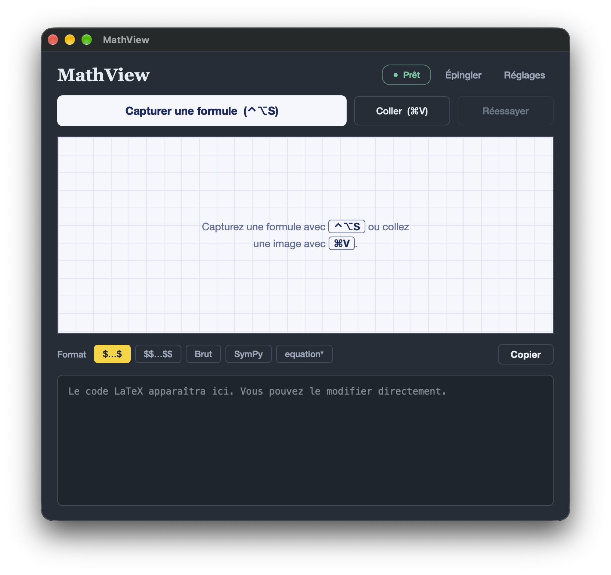
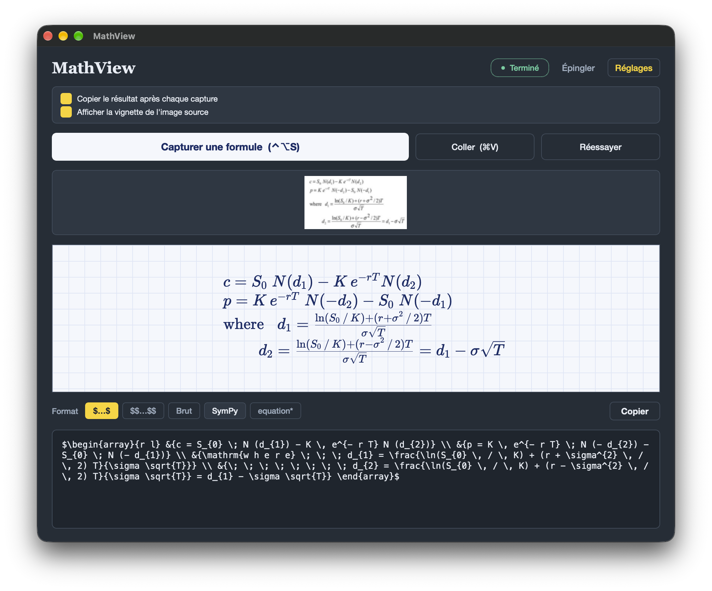

<h1 align="center">
  
  MathView
</h1>

<p align="center">
  <a href="https://www.python.org/downloads/"></a>
  <a href="https://opensource.org/licenses/MIT"></a>
  
  <br>
  
  
  <br>
  
  
</p>

<p align="center">
  Application de reconnaissance de formules mathématiques : capturez une zone de l'écran, obtenez le code LaTeX.<br>
  Interface PySide6, OCR UniMERNet exécuté en local, aperçu KaTeX en direct.
</p>

---

## Fonctionnalités

### Reconnaissance de formules

| Composant                                          |                                      Rôle                                      |
| :------------------------------------------------- | :-----------------------------------------------------------------------------: |
| **UniMERNet** (`wanderkid/unimernet_base`) |                 Image de formule vers LaTeX, exécuté en local                 |
| **Prétraitement d'image**                   | Fond blanc sur images transparentes, inversion automatique des captures sombres |
| **Nettoyage LaTeX**                          |                 Suppression des espaces sans effet entre jetons                 |
| **Conversion SymPy**                         |             Formule LaTeX vers expression SymPy (`latex2sympy2`)             |

### Entrées d'image

- **Capture d'écran** par sélection d'une zone, via un overlay plein écran
- **Glisser-déposer** d'un fichier image ou d'une image depuis une autre application
- **Collage** d'une image depuis le presse-papiers (`Cmd+V`)
- **Relance** de l'analyse sur la dernière image, sans nouvelle capture

### Formats de sortie

| Identifiant                | Libellé                | Résultat                               |
| :------------------------- | :---------------------- | :-------------------------------------- |
| `LaTeX-$`   | `$…$`   | Formule en ligne        |                                         |
| `LaTeX-$$`  | `$$…$$` | Formule en mode display |                                         |
| `Raw`                    | Brut                    | LaTeX sans délimiteur                  |
| `SymPy`                  | SymPy                   | Expression Python utilisable avec SymPy |
| `Env`                    | `equation*`           | Environnement`\begin{equation*}…`    |

### Intégration macOS

- **Raccourci global** `Ctrl + Option + S`
- **Affichage au-dessus des applications en plein écran** (mode « accessoire » macOS)
- **Notification et copie automatique** lorsque la capture est lancée fenêtre masquée

### Performance et robustesse

- Chargement du modèle en arrière-plan au démarrage, analyse dans un thread dédié : l'interface reste fluide
- Téléchargement du modèle au premier lancement, puis **mode hors ligne** (`HF_HUB_OFFLINE`) : aucune requête réseau ensuite
- Vérification des poids après chargement : un modèle aux poids aléatoires est refusé
- Calcul sur processeur par défaut, GPU du Mac (MPS) en option, avec **repli automatique sur le processeur** en cas d'échec

---

## Interface

Une feuille à petits carreaux posée sur un bureau en ardoise. La formule y est composée à l'encre ; le surligneur jaune ne marque que ce qui est actif (format choisi, sélection, focus).





## Architecture

### Interface ↔ logique via signaux Qt

L'affichage et la logique sont séparés. La fenêtre n'expose que des signaux (actions de l'utilisateur) et des méthodes (ordres d'affichage) ; le contrôleur relie les deux.

```
┌─────────────────────────────────────────────────┐
│                  mathview_ui.py                 │
│   PySide6 · Qt WebEngine · KaTeX · SnipOverlay  │
│   MathViewWindow · DropSurface · MenuBarItem    │
└────────────────────┬────────────────────────────┘
                     │  signaux / méthodes Qt
┌────────────────────▼────────────────────────────┐
│                 mathview_app.py                 │
│   MathViewController · GlobalHotkey             │
│   ModelLoaderThread · OCRWorker                 │
└──────────┬───────────────────────┬──────────────┘
           │                       │
           ▼                       ▼
  mathview_engine.py        latex2sympy2
  (UniMERNet, sans Qt)      (format SymPy)
```

Le moteur OCR ne dépend pas de Qt : il peut être testé seul en ligne de commande.

```Shell
python mathview_engine.py formule.png            # processeur
MATHVIEW_DEVICE=mps python mathview_engine.py formule.png   # GPU du Mac
```

---

## Installation

### Prérequis

- macOS (raccourci global, barre des menus et affichage plein écran reposent sur Carbon / AppKit)
- **Python 3.12 obligatoire** : `transformers 4.42.4` impose `tokenizers 0.19.1`, qui n'a pas de version précompilée pour Python 3.13
- Environ 1,3 Go d'espace disque pour le modèle `base` (773 Mo pour `small`, 441 Mo pour `tiny`)
- KaTeX placé dans `resources/katex/` (`katex.min.js`, `katex.min.css` et le dossier `fonts/`)

### Étapes

```Shell
# 1. Cloner le dépôt
git clone https://github.com/nono271105/mathview.git
cd mathview

# 2. Environnement virtuel dédié (ne pas réutiliser un ancien venv)
python3.12 -m venv venv-unimer
source venv-unimer/bin/activate

# 3. Dépendances Python
pip install -r requirements.txt
pip install --no-deps unimernet==0.2.3

# 4. Lancement (le modèle est téléchargé au premier démarrage)
python mathview_app.py
```

L'installation de `unimernet` avec `--no-deps` évite `opencv-python` (non headless), en conflit avec les plugins Qt de PySide6, ainsi que des dépendances d'entraînement inutiles.

### Configuration

| Variable            | Valeur par défaut | Effet                                                         |
| ------------------- | :----------------: | ------------------------------------------------------------- |
| `MATHVIEW_DEVICE` |      `cpu`      | `cpu`, `mps` ou `auto` (GPU du Mac s'il est disponible) |

Le choix du modèle (`base`, `small`, `tiny`) se règle avec `UNIMER_VARIANT` dans `mathview_engine.py`. Le raccourci de capture se règle avec `SNIP_SHORTCUT_QT` dans `mathview_ui.py` et `GlobalHotkey` dans `mathview_app.py`. Le mode barre des menus se désactive avec `MENU_BAR_ONLY = False`.

---

## Structure du projet

```
mathview/
├── mathview_app.py          # Point d'entrée, contrôleur, threads, raccourci global
├── mathview_ui.py           # Fenêtre, thème, aperçu KaTeX, overlay de capture
├── mathview_engine.py       # Moteur UniMERNet (sans Qt), test en ligne de commande
│
├── resources/
│   └── katex/               # katex.min.js, katex.min.css, fonts/
│
├── models/                  # Créé lors du premier lancement
│   └── unimernet_base/      # config, tokenizer, pytorch_model.pth
│
├── requirements.txt
└── README.md
```

---

## Dépendances principales

| Package                                    | Usage                                           |
| ------------------------------------------ | ----------------------------------------------- |
| `PySide6`                                | Interface Qt, Qt WebEngine pour l'aperçu KaTeX |
| `pyobjc-framework-Cocoa`                 | Mode barre des menus, affichage plein écran    |
| `torch` / `torchvision`                | Exécution du modèle (CPU ou MPS)              |
| `transformers` 4.42.4                    | Version exigée par UniMERNet                   |
| `unimernet` 0.2.3                        | Modèle de reconnaissance de formules           |
| `timm` `<0.10`                         | Encodeur visuel                                 |
| `albumentations` `<2`                  | Prétraitement d'image                          |
| `opencv-python-headless`                 | Traitement d'image sans conflit avec Qt         |
| `huggingface_hub`                        | Téléchargement du modèle                     |
| `omegaconf` / `iopath` / `fairscale` | Importés au chargement du paquet`unimernet`  |
| `pillow`                                 | Manipulation d'images                           |
| `latex2sympy2` 1.5.4                     | Format de sortie SymPy (optionnel)              |
| `sympy`                                  | Format de sortie SymPy (optionnel)              |

---

## Licence

MIT : voir [`LICENSE`](LICENSE).

---

*Dernière mise à jour : octobre 2026 : moteur UniMERNet, aperçu KaTeX, raccourci global et mode barre des menus macOS*
